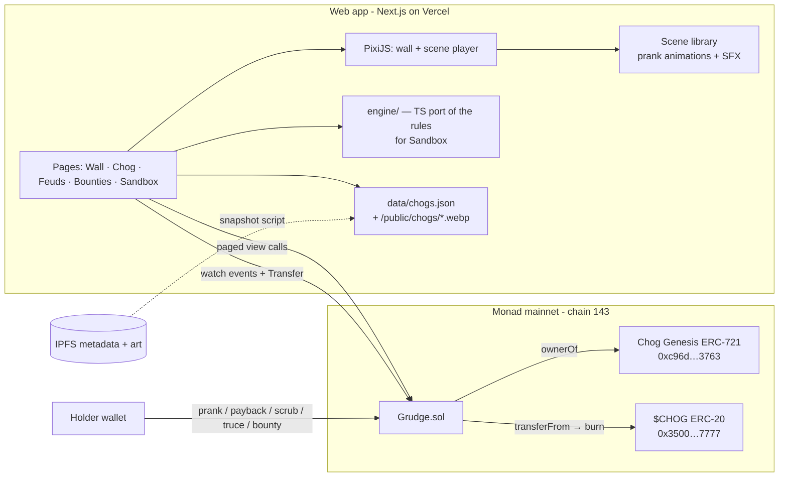

# Grudge — Architecture

Chogathon 2026 entry. Submissions close **Oct 23, 15:00 UTC**.

## Pitch

Chogs prank other Chogs. Every prank is a transaction aimed at a specific token id, and it sticks to the target's face as a visible scar. Victims get one payback that hits harder, so beefs escalate between specific tokens. When a Chog is sold, the buyer inherits its graffiti, its enemies and its open vendettas. $CHOG is burned to scrub scars, end a beef, or put a bounty on a Chog.

### Why it stands out (and what we're up against)

`cipoklean/chog-mischief` (built Oct 9) already has daily pranks keyed to token ids, art overlays, 2x revenge, cleaning and rivalry boards. We don't win by matching its feature list. We win on these differences:

| Chog Mischief | Grudge |
|---|---|
| Signed messages, a server rolls the outcome, "no transactions, no gas" | **Fully onchain.** Every prank, payback and scrub is a Monad transaction and a public event. Nothing a server can fake or lose. |
| Dodge chances and trait rolls, so pranks can miss | **Pranks always land.** The fun is the performance, not a dice roll. |
| Overlays are static layers | **Each prank is a short animated scene** (spray strokes, hat yanked off, stink cloud rolling in), with sound, and a bigger cinematic for payback. |
| No token use ("nothing here costs money") | **$CHOG is in the core loop**: scrub, truce and bounties are burns. Meaningful use earns the bonus. |
| Rankings and profile pages | **The Wall**: one live zoomable mural of all 1,969 Chogs where scars appear as transactions land, plus a draggable **Feud graph** of rival token pairs. |
| Reputation moves with the token | **Sale ceremony.** When a Chog changes hands, the app shows the new owner exactly what they inherited: scars, enemies, open paybacks. |

**NFT gate:** no Chog means no attacker, no target and no canvas to deface. State is keyed by token id and ownership is checked onchain at call time.

## System overview



No backend and no database. All state lives in `Grudge.sol` and its events. Art and traits are snapshotted from IPFS once at build time.

## Components

### 1. `contracts/` — Grudge.sol (Foundry)

- Constructor takes the Chog Genesis address, the $CHOG address and the price table.
- Every action checks `IERC721(chog).ownerOf(id) == msg.sender` at call time, so a buyer controls the token's state immediately and the seller loses it.
- `from` and `to` must have different owners (stops one wallet farming itself). No admin power over any token's state.
- Owner-only: `setPrices` (scrub, truce, bounty fee), `setOwner`.
- The full rule set ships before the mainnet deploy, because the contract can't be changed afterwards. Adding rules later would mean redeploying and wiping real players' scars.

### 2. `web/` — Next.js app (App Router, TypeScript)

| Route | What it is |
|---|---|
| `/` | **The Wall**: a zoomable, pannable PixiJS mural of all 1,969 Chogs with their scars. New pranks pop in live as events arrive, with a ticker and a "most wanted" strip. |
| `/chog/[id]` | **Rap sheet**: scarred portrait, timeline of everything done to it and by it, open paybacks, current beefs, notoriety. Shareable OG image. This is the screenshot screen. |
| `/prank` | **The prank flow**: pick your Chog, pick a target, pick a move, watch the scene play, confirm. Also hosts the payback cinematic. |
| `/feuds` | **Feud graph**: a draggable d3-force graph of token pairs built from the onchain log. Edges thicken with hits and turn red after a payback. Includes leaderboards: hottest beefs, most wanted, most bullied. |
| Bounties | Posted and shown on each rap sheet, and badged on the victim in the prank room. A separate `/bounties` page is cut: there's no onchain index of open bounties, and the badge plus rap sheet cover discovery. |
| `/sandbox` | **The judge path.** No wallet needed. A fake Chog, a bot opponent and a fast clock run on the local TS engine so anyone can see a prank, a payback and a scrub in two minutes. |

- Wallet: wagmi + viem with injected wallets and our own connect UI (RainbowKit dropped: it needs a WalletConnect project id and fights the custom look). On the local fork, a dev-only "play as the holder of Chog #N" uses anvil impersonation.
- Rendering: prank **scenes** are SVG + GSAP (DrawSVG, MotionPath) drawn over the Chog art in a 1000×1000 box. Each scene is built from `from` tweens, so it settles exactly into the permanent scar, and it uses the same seed (attacker, kind, block time, target) as the stored scar, so the handoff is seamless. PixiJS v8 is used only for the Wall, where 1,969 tiles need WebGL. Wall tiles show the same scar art, rendered to textures.
- Sound: synthesized in the browser with WebAudio (spray hiss, splat, whoosh, boing, stamp). No audio files. Mute toggle remembered in localStorage.
- Provenance banner: `/api/transfers/[id]` scans Chog Genesis `Transfer` logs since the Grudge deploy block. It uses `rpc2.monad.xyz`, which allows 10k-block windows (the main RPC allows 100), and keeps the result in `'use cache: remote'` so cold serverless instances don't rescan. Chog Genesis isn't ERC721AQueryable, so there's no onchain ownership timestamp to read. If a Chog changed hands after its first Grudge activity, the rap sheet shows an INHERITED card plus a CHANGED HANDS divider in its timeline, and the prank room tells the buyer its enemies are now theirs.
- Transactions: one `useGrudgeTx` hook switches the wallet to Monad if needed, approves the exact $CHOG burn when the allowance is short, sends, waits and refreshes. A wrong-network strip sits under the header.

### 3. `engine/` — rules in TypeScript

A pure-function port of the contract rules (daily moves, heat, payback eligibility, scar slots) for Sandbox and for previews before you sign. Shared test vectors keep Solidity and TS in step.

### 4. `scripts/snapshot`

Reads `tokenURI` for ids 1–1969 (metadata files are shuffled: token 1 → `1462.json`), fetches metadata through the Pinata gateway (ipfs.io and dweb.link no longer serve raw files), writes `data/chogs.json` (id, name, traits, image CID) and downsamples each image to 256px WebP in `public/chogs/`.

## Game rules (v1)

| Thing | Rule |
|---|---|
| Daily moves | 3 per Chog per UTC day. Payback does not use a move. |
| Prank kinds | `graffiti`, `hat steal`, `stink cloud`, `tomato`, `googly eyes` (5 at launch, each its own scene). |
| One target per day | A Chog can prank the same target once per day, so one victim can't be spammed by one attacker. |
| Scars | Each token holds up to 8 scar slots. A new prank takes the next slot, and when full it paints over the oldest. A scar records kind, attacker token id and time. |
| Heat | Each ordered pair of tokens has a heat level 0–3. A prank raises the target→attacker heat. Heat decays by one level per day with no contact. |
| Payback | The victim of a prank gets one payback against that attacker for 3 days. It lands a **heavy** version of a scar (bigger scene, counts double toward notoriety) and raises heat two levels. |
| Notoriety | Pranks landed score 1, paybacks and bounty claims score 2. Shown as "Most Wanted" and "Most Bullied" (scars received). |
| Scrub | Burn `SCRUB_PRICE` $CHOG to clear one chosen scar slot. |
| Truce | Both owners agree to end a beef. One side proposes by burning `TRUCE_PRICE`, the other accepts by burning the same. Heat goes to 0 both ways and open paybacks between them are voided. |
| Bounty | Burn-and-escrow: a holder escrows $CHOG on a target. The first Chog (other than the funder's own) to prank the target claims it, minus a fee that is burned. Funder can cancel after 3 days with no claim, for a refund. |

Burning means `transferFrom(holder, 0x…dEaD, amount)`, which needs an approve first. Prices are set at deploy once we've checked $CHOG liquidity.

## Data model (onchain)

```solidity
struct Scar { uint16 by; uint8 kind; uint8 heavy; uint32 at; }   // by = attacker tokenId+1

struct Chog {                 // per tokenId
  uint32 day;  uint8 used;    // daily moves
  uint16 landed; uint16 received; uint32 notoriety;
  uint8  next;                // ring cursor for scar slots
  Scar[8] scars;
}
mapping(uint256 => Chog) chogs;
mapping(bytes32 => Beef) beefs;   // key = (min(a,b), max(a,b)) → heat, lastAt, paybackFor
struct Bounty { uint16 target; address funder; uint96 amount; uint32 createdAt; bool open; }
```

Events: `Pranked`, `Scrubbed`, `TruceOffered`, `Truce`, `BountyPosted`, `BountyClaimed`, `BountyCancelled`.

**Onchain history log.** Monad's public RPC limits `eth_getLogs` to 100 blocks (~40 s), so rebuilding history from events would need an indexer. Instead every action appends one 32-byte `Entry {act, from, to, kind, at}` to `_log`, and each Chog keeps an index into it. That adds roughly 50k gas per prank and keeps Grudge indexer-free:
- `logLength()` + `getLog(start, count)`: global feed. The Wall polls the length every 1.5 s and pulls only new entries.
- `chogLogLength(id)` + `getChogLog(id, start, count)`: a Chog's rap sheet.

Views: `getChogs(start, count)` returns stats and scars in pages of 250, so the Wall loads in 8 calls. Also `heat(a, b)`, `movesLeft(id)`, `paybackUntil(victim, attacker)`.

## Key demo flows

1. **Watch the Wall:** open `/`, zoom into a busy corner, watch a prank scene play on a Chog as the transaction lands.
2. **Land a prank:** pick your Chog, pick a target, choose graffiti, watch the strokes go on, confirm the transaction, and see the scar settle into the portrait.
3. **Payback:** open an inbox notice of a prank against your Chog, trigger the heavy payback cinematic on the attacker, and see the feud edge thicken.
4. **Sale ceremony:** open a Chog that recently changed hands and see the "you inherited this" screen listing its scars and enemies.
5. **Burn to fix it:** scrub a scar with $CHOG, or post a bounty and watch it claimed.

## Stack and why

- **Monad mainnet + Foundry:** that's where Chog Genesis lives. Foundry tests run against a mainnet fork, so the real `ownerOf` is exercised.
- **Next.js + Vercel:** playbook default, gives a live link early.
- **No database, no indexer:** the onchain log and paged views cover the feed, rap sheets and the Wall at 1,969 tokens, and "all onchain" is part of how we differ from Mischief.
- **Next.js 16 with `cacheComponents`:** route params, search params and `Date.now()` must sit behind Suspense or run after mount; the pages follow that pattern.
- **PixiJS:** WebGL is needed for animated scenes and a 1,969-tile wall at 60 fps.

## Visual direction

Hand-made and chunky, not a crypto dashboard. Paper-and-marker feel for the chrome: a warm off-white with a real dark mode, a heavy display face for headings, a mono face for token ids and timestamps, and one loud accent (spray-paint orange). Scars use ink-and-marker textures so they read as drawn on, not stamped. No gradients, no glassmorphism, no emoji icons.

**Deviation from the playbook:** more motion and sound than "only where it carries meaning", because each prank scene is the product and Fun plus Retention are 40% of the score.

## Out of scope

- Any backend, accounts, push or email notifications (the in-app inbox and the live ticker cover retention)
- Dodge or luck mechanics, trait-based powers
- Other chains, and mobile-native
- Real-money marketplace features beyond reading `Transfer` events

## Milestones

| # | Target | Done when |
|---|---|---|
| **M1** — thinnest slice | Oct 15 ✅ Oct 13 | Full Grudge.sol (all rules, since it's immutable after M2), unit tests plus a mainnet-fork test. Next.js app: connect wallet, see your Chogs, prank a target, see scars, pay back. Running locally against an anvil fork. |
| **M2** — the spectacle | Oct 17 ✅ Oct 13 | Metadata snapshot, Wall with live events, first 3 prank scenes with sound, rap sheet page. **Mainnet deploy and announce** in the Chog Discord and on X, so real usage exists before judging. |
| **M3** — escalation | Oct 19 | ✅ Oct 14. Wrong-network prompt, $CHOG scrub, truce and bounties in the app, inheritance banner, feud graph with leaderboards. |
| **M4** — judge-proof | Oct 21 | Sandbox mode, onboarding and empty, loading and error states, polish pass, OG images. |
| **M5** — ship | Oct 22 | README, demo video script, submission copy, usage stats for the "What's next" field. Oct 23 morning is buffer only. |
